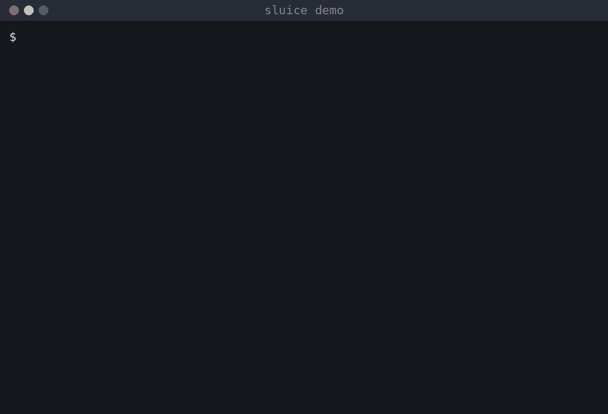

<h1 align="center">Sluice</h1>

<p align="center">
  <strong>Verify each git tree once.</strong><br>
  A stack-agnostic verification queue and cache for parallel coding agents.
</p>

<p align="center">
  <a href="https://github.com/josegarridodigio/sluice/actions/workflows/ci.yml"></a>
  <a href="LICENSE"></a>
  
  
  
</p>

> **Status: pre-alpha, Phases 1–4 done.** `sluice run` caches gate results
> per git tree, a per-user daemon queues misses under a weighted budget,
> coalesces identical requests and holds new work while the machine is
> under pressure (Linux PSI), and `sluice mcp` gives coding agents a
> `verify` tool that blocks safely. A first release and real-world numbers
> come next; see the [roadmap](#roadmap).



*Six requests for the same tree: one run, five coalesced, and a repeat served from the cache.*

---

## The problem

You run four Claude Code agents on the same project, each in its own git
worktree. Every one of them triggers the same `pre-commit` and `pre-push`
checks: the full test suite, the linter, the type checker, maybe CodeQL.
Four agents, four copies of everything, at once. The laptop fans spin up,
every agent slows down, and the machine stops answering.

Looking closer, three different things go wrong:

| Cause | What happens | Who should fix it |
|---|---|---|
| **Uncontrolled concurrency** | N agents, N simultaneous suite runs. Hooks live in the shared `.git/hooks`, so nothing coordinates between worktrees. | Sluice |
| **Redundancy** | The same tree is verified by the agent, then by `pre-commit`, then by `pre-push`, then after a no-op rebase, then by the coordinator's merge push. Real-world reports found more than half of suite runs were on trees already proven green, and pushes taking 13–16 minutes mostly because `pre-push` redid `pre-commit`'s work. | Sluice |
| **Excessive scope** | Full suites where a changed-files subset would do. | Your gate commands. Sluice just makes narrow gates easy to declare. |

And one hard constraint: the agent's shell tool has a timeout. A git hook
that sits in a queue runs *inside* the agent's `git commit` call. If it
waits too long, the agent moves on without the result. Any fix has to
respect that.

## What Sluice does

- **Caches results per tree.** The cache key is the exact content of the
  working tree (tracked, staged, unstaged and untracked non-ignored files)
  plus the gate definition. A tree that passed `test` once passes `test`
  everywhere: in another worktree, after a no-op rebase, at push time. Hits
  return in milliseconds and never need the daemon.
- **Bounds concurrency globally.** A per-user daemon runs gates under a
  budget; each gate declares a weight, so heavy suites take more of it
  than a linter. The queue is FIFO with backfill and a head-of-line
  reservation so heavy jobs never starve, and admission pauses while the
  machine is under real pressure (Linux PSI `some avg10` above 60 % CPU or
  20 % memory by default, `[admission]` in the user config).
- **Coalesces identical requests.** Two agents asking for the same tree
  and gate share one run; the second just waits for the first one's
  result. If a marker appears while a request is queued, it completes
  without running. No other tool in this space does this.
- **Two front-ends, one brain.** `sluice run <gate>` for git hooks, humans
  and scripts; `sluice mcp` for agents, as an MCP server over stdio. Both
  talk to the same daemon and share cache, queue and logs.
- **Never hangs inside an agent.** On a cache miss in a hook invoked by an
  agent, Sluice fails fast with an actionable message (run the gate
  through Sluice first, then retry) instead of waiting. Humans wait,
  because humans are not subject to tool timeouts.
- **Stays out of your stack.** Sluice knows nothing about npm, cargo or
  pytest. It runs named shell commands ("gates") from a small TOML file and
  works with any hook manager: Husky, lefthook, pre-commit/prek, plain
  `.githooks/`.
- **Keeps agent context small.** Full output goes to a log file. Callers
  get one line on success and the tail of the log on failure.

## How it works

```
 git hook ──▶ sluice run ──┐                        ┌──▶ gate (process group)
 terminal ──▶ sluice run ──┼──(Unix socket)──▶ daemon ─┼──▶ gate (process group)
 agent    ──▶ sluice mcp ──┘                        └──▶ …  bounded by budget
                │
                └── cache hit: marker found under .git/, exit 0 in milliseconds,
                    no daemon involved
```

The daemon starts itself the first time a miss needs it and keeps running
until `sluice daemon stop`. If it cannot be reached, `sluice run` runs the
gate in-process under a file-lock semaphore instead, so a broken daemon
never blocks a commit.

1. The client computes the tree hash from a **private copy of the index**
   (`git add -A` + `git write-tree` against a scratch index and a scratch
   object directory). Your real index, `index.lock` and object store are
   never touched.
2. It derives the cache key from the tree, the gate name, the normalised
   command, the gate's environment, and any extra inputs you declare
   (`key_inputs` such as `node --version`, `key_files` such as `.env.test`).
3. If a marker for that key exists under
   `$(git rev-parse --git-common-dir)/sluice/markers/<key>.json`, that is a
   hit. Markers are shared by every worktree of the repository. The key
   layout and the marker format are a documented contract
   ([design note](kb/sluice/design/cache-key.md)).
4. Otherwise the request goes to the daemon, which attaches it to an
   identical in-flight job or queues it under the budget, runs it in its
   own process group with output captured to a log, and streams
   `queued` / `started` / `done` back.
5. Only a run that exits 0 **and leaves the tree unchanged** writes a
   marker. Auto-fixers that modify files always get re-verified.

A gate definition looks like this:

```toml
# .sluice.toml
version = 1

[defaults]
agent_hook_policy = "fail-fast"   # fail-fast | wait | run-unqueued

[gates.lint]
cmd = "npm run lint"
weight = 1
hooks = ["pre-commit"]

[gates.test]
cmd = "npm test -- --maxWorkers=2"
weight = 4
timeout = "20m"
hooks = ["pre-commit", "pre-push"]
key_inputs = ["node --version"]
key_files  = [".env.test"]
env        = { NODE_ENV = "test" }
```

## Command surface

```
sluice run <gate> [--hook <hook>] [-v] [--explain] [-- args]  # hooks, terminal, scripts (Phase 1)
sluice cache status [--all] | clear [--gate <gate>]      # markers of the current repo (Phase 1)
sluice init [--force]                                    # starter .sluice.toml + hook snippet (Phase 1)
sluice hook print husky|lefthook|pre-commit|plain        # integration snippets         (Phase 1)
sluice logs [<job-id>] [-n <lines>]                      # job logs                     (Phase 1)
sluice daemon [--foreground] | stop [--force] | restart [--debug] [--force]   # one per user, Unix socket (Phase 2)
sluice status [--json]                                   # queue, in-flight, totals     (Phase 2)
sluice mcp                                               # MCP stdio server for agents  (Phase 3)
sluice queue enqueue|status|approve|retry|cancel|reconcile   # local merge queue    (Phase 6)
sluice doctor [--json] [--bundle [PATH]]                 # health checks, redacted bug-report bundle
```

### Use with coding agents

For Claude Code, install the plugin: it registers the MCP server, loads a
skill that teaches the agent the verify and merge-queue flow, and adds a hook
that redirects raw test commands to `verify`. With `sluice` in your `PATH`:

```
/plugin marketplace add josegarridodigio/sluice
/plugin install sluice@sluice
```

No `CLAUDE.md` block is needed. Details in [plugin/README.md](plugin/README.md).
Other agents: register `sluice mcp` as an MCP server and paste the
`AGENTS.md` block from [docs/agents.md](docs/agents.md).

```
```

Exit codes of `sluice run`: 0 pass or cache hit; the gate's own code on
failure; 3 refused by `agent_hook_policy = "fail-fast"`; 124 timeout; 143
gate killed by a signal; 1 Sluice error; 2 usage error. `sluice run --explain <gate>` shows every
decision Sluice would take without running anything.

Defaults worth knowing: gate timeout 30 m, weight 1, cache TTL 30 days,
budget `max(2, cpus - 1)`, 40 log lines shown on failure (set
`defaults.tail_lines` per repository or `cache.tail_lines` in the user
config). Full output of every run is kept in
`~/.local/state/sluice/logs/`; `sluice logs` prints the newest one.

Environment switches: `SLUICE_DISABLE=1` makes `sluice run` run the gate
directly (no cache, no budget, no log; through the MCP server it only
turns the cache off); `SLUICE_CACHE=0|1` forces the cache off or on
(on overrides `CI`); `CI` (any value other than `0`/`false`/`no`/`off`)
disables the cache; `SLUICE_AGENT=1|0` forces agent or human detection;
`SLUICE_CONFIG` points at the user config
(`~/.config/sluice/config.toml`); `SLUICE_SOCKET` moves the daemon socket;
`SLUICE_LOG` sets the log filter of `sluice daemon` (written to
`~/.local/state/sluice/daemon.log`) and `sluice mcp` (stderr), `info` by
default.

`sluice status` prints the daemon (pid, version, uptime, socket), budget
use, system pressure (`pressure: cpu 12.3% mem 0.4% (ok|blocking admission|unavailable)`),
running and queued jobs with the reason each one waits (`budget`,
`repo-cap`, `head-reserved`, `psi`), and all-time totals (runs, passes,
failures, timeouts, hits, coalesced requests, time saved). `--json` is the
stable export for dashboards (schema 1). `sluice daemon stop` lets running gates finish and waits for the
daemon to exit; `--force` kills them. `sluice daemon` exits 75 when a
daemon is already running.

MCP tools for agents: `verify` (blocks until the gates finish, with
progress notifications and cancellation), `status`, `gate_list`, `logs`.

## Debugging

Every log lives under `~/.local/state/sluice/`: `daemon.log`, `logs/mcp-<pid>.log`
for each `sluice mcp`, `logs/client.log` (one line per `sluice run`) and one
log per job. Raise the level with `sluice daemon restart --debug` or
`[debug] level` in the user config. `sluice doctor` checks the installation
and `sluice doctor --bundle` writes a redacted `.tar.gz` to attach to a bug
report. See [docs/debugging.md](docs/debugging.md).

## Merge queue

Agents working in separate worktrees can hand their committed branches to a
local merge queue instead of pushing. `sluice queue enqueue` records the
branch; the daemon merges the queued branches onto the target in a throwaway
worktree, runs the gates once on the combined tree (through the usual cache
and budget) and shows the plan in `sluice queue status`. Nothing is pushed
until a human runs `sluice queue approve <train>`, which prints the plan and
lands the train atomically. Agents enqueue, humans approve; add
`Bash(sluice queue approve:*)` to the agent's deny rules. The full guide is in
[docs/merge-queue.md](docs/merge-queue.md).

## Roadmap

| Phase | Scope | Status |
|---|---|---|
| 0 | Research, design, ADRs, workspace | done |
| 1 | Cache only, no daemon: `sluice run`, markers, TTL, hook snippets, agent detection and `agent_hook_policy`, a file-lock semaphore | done |
| 2 | Daemon: budget scheduler, coalescing, process groups, timeouts, SQLite metrics, `sluice status` | done |
| 3 | MCP server (`verify`, `status`, `gate_list`, `logs`), `docs/agents.md` | done |
| 4 | PSI-based admission, stable `--json` schema (`sluice status --json` is the metrics export) | done |
| 5 | Release builds, install script, real-world numbers | done |

Design history lives in [`kb/`](kb/sluice/plan/master-plan.md): the plan,
the architecture, one ADR per decision, and research notes on the projects
Sluice learned from.

## Install

Prebuilt static binaries for Linux x86_64 and aarch64 come with every
[release](https://github.com/josegarridodigio/sluice/releases). The
installer downloads the latest one into `~/.local/bin` (set
`SLUICE_VERSION=v0.1.0` to pin, `SLUICE_INSTALL_DIR` to relocate):

```sh
curl -fsSL https://raw.githubusercontent.com/josegarridodigio/sluice/main/scripts/install.sh | sh
```

Later, `sluice update` upgrades in place (checksum-verified; `--check` only
reports whether a newer release exists).

Or from source, with a stable Rust toolchain (git ≥ 2.31 at runtime):

```sh
cargo install --path crates/sluice-gate
```

Then, in your repository:

```sh
sluice init                          # writes .sluice.toml, prints the hook snippet
sluice hook print husky              # or lefthook | pre-commit | plain
```

The crate is `sluice-gate` because `sluice` is taken on crates.io by an
unrelated library. The binary is `sluice`. Homebrew also ships an unrelated
`sluice` (a Maven index parser); if you have both, check which one is first
in `PATH`.

## Requirements

- Linux. The only supported platform in v1.
- `git` in `PATH`. Nothing else at runtime.

## Things to know before trusting a cache hit

- A hit is a **local optimisation**. CI stays authoritative. Caching is off
  when `CI` is set unless you export `SLUICE_CACHE=1`.
- Inputs git cannot see (tool versions, environment variables, ignored
  files, running services) must be declared with `key_inputs` and
  `key_files`, or a stale pass is possible.
- Agents bypass the queue whenever they can run the test command directly
  through their shell tool. Permission rules such as `Bash(npm test:*)`, or
  running with permissions bypassed, make that easy. The Claude Code
  plugin ([plugin/README.md](plugin/README.md)) ships a hook that denies the
  raw commands your gates run; for other agents, tell them to verify through
  Sluice ([docs/agents.md](docs/agents.md) has a ready-to-paste section).

## Prior art

Sluice reimplements ideas from three projects and tries to combine what
each one got right:

- [gate-cache](https://github.com/natelandau/gate-cache): skip a command
  that already passed on the same tree. Sluice takes its tree hashing from a
  private index copy and adds a queue, coalescing and declared key inputs.
- [agent-task-queue](https://github.com/block/agent-task-queue): an MCP
  task queue so agents do not hit shell timeouts. Sluice takes the
  MCP-blocks-instead-of-the-shell insight and the output-to-file design,
  and adds a cache, weights and load awareness.
- [mergetrain](https://github.com/yongjip/mergetrain): a local merge queue
  for agent worktrees. Sluice borrows its lease-fenced single-runner
  discipline for the daemon.

See [THIRD_PARTY_NOTICES.md](THIRD_PARTY_NOTICES.md).

## Contributing

Issues and discussions are open. The quality bar is in
[CONTRIBUTING.md](CONTRIBUTING.md): `cargo fmt`, `cargo clippy -D warnings`,
`cargo test`, and a knowledge-base note for every change.

## License

MIT. See [LICENSE](LICENSE).
